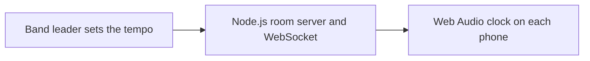

# Band Sync Metronome

## Architecture

A shared metronome for musicians who want a common beat on several phones.

### Follow one interaction

The leader chooses a tempo and starts a song. The server distributes a start time and song settings. Each phone uses its own audio clock to schedule the clicks.

## APIs and interfaces

| Connection | What crosses it |
| --- | --- |
| Browser → room server | A WebSocket carries room settings, clock samples and the shared start time between phones and the Node.js server. |
| Browser → speaker | The Web Audio API schedules the local click. A slow network message therefore has a different effect from a late audio callback. |

### Why it works this way

Sending the start time once avoids making every beat depend on the arrival time of a network packet. Room membership and reconnects are handled separately from audio playback.

## Source in this repository

Read [meter.mjs](meter.mjs) to see how a signature such as 7/8 (2+2+3) becomes beat groups for playback. This is an excerpt from the original app.

[Back to the project index](https://github.com/IT-Yun/IT-Yun)
